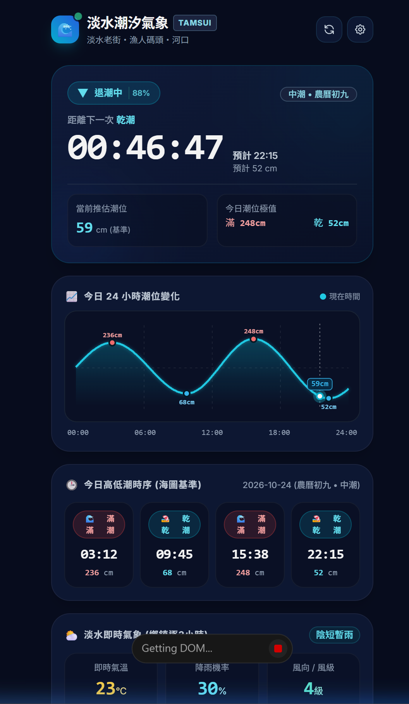

  介面順序要調整
第一個區塊
1.要增加顯示當前時間，讓大家知道現在是幾點幾分
2.整合淡水即時氣象的資訊到主區塊
3.搬移當前推估潮位&潮位極值的區塊資訊卡，放到最下方24小時潮位變化圖
4.漲潮中/退潮中的字要大

第二區塊應該是"今日高低潮順序"
今日高低潮時序卡片的文字大一點，然後只要寫滿潮 乾潮 ，不需要加icon 我要給老人看的，要簡單易懂好閱讀

24小時潮位變化圖區塊放在最下方
